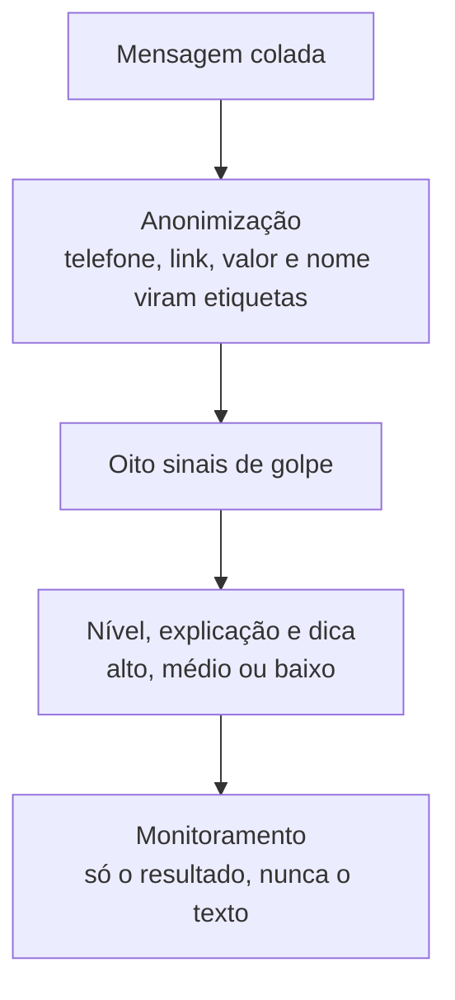

# Alerta Golpe

[](#demonstração)
[](https://github.com/RFontess/alerta-golpe/actions/workflows/ci.yml)
[](LICENSE)


Protótipo em Python que analisa uma mensagem de SMS ou WhatsApp, diz se ela tem sinais
de golpe financeiro, mostra quais sinais encontrou e dá uma dica de segurança em
linguagem simples. O público são pessoas idosas e quem as ajuda.

É o protótipo do meu Trabalho de Graduação na Fatec.

## Demonstração

Ainda não publicado. Para ver o app funcionando agora, rode local com os comandos de
[Como rodar localmente](#como-rodar-localmente): a tela traz três exemplos prontos, um de
cada nível, que preenchem a caixa com um clique.

## Em resumo

- O que faz: a pessoa cola uma mensagem e o app diz se ela tem sinais de golpe, mostra
  quais encontrou e o que fazer, em linguagem simples.
- Resultado: nas 99 mensagens reais da base, o app reconheceu 51 dos 57 golpes e deu
  alarme falso em 10 das 42 legítimas. Nos golpes por SMS, que são o caso de uso, foram
  14 de 17, contra 11 do classificador de machine learning com o mesmo número de alarmes
  falsos. Os números são otimistas, pelos motivos em
  [Limites e ressalvas](#limites-e-ressalvas).
- Como foi avaliado: sete configurações (regras, TF-IDF com regressão logística e
  híbridos), validação cruzada por grupo e um critério de escolha fixado antes de medir.
- Dados: base de 139 mensagens montada para o projeto, de fontes públicas e do meu
  e-mail, anonimizada (LGPD) e documentada em [data card](data/README.md).
- Produto: app em Streamlit pensado para pessoas idosas, com monitoramento das respostas
  em SQLite e exportação para Excel.
- Tecnologias: Python, pandas, scikit-learn, matplotlib, Streamlit, SQLite, openpyxl,
  pytest e ruff.
- Desenvolvimento: com IA como ferramenta (Claude Code), em etapas revisadas; ver
  [Como foi feito](#como-foi-feito).

## O problema

No estado de São Paulo, 82% das pessoas com 60 anos ou mais já sofreram tentativa de
golpe virtual, e 68% acham praticamente impossível se proteger de golpes on-line
(Fundação Seade, série Seade SP TIC, pesquisa de julho a setembro de 2025,
[reportagem](https://tiinside.com.br/12/03/2026/em-sao-paulo-82-dos-idosos-sofreram-tentativas-de-golpes-virtuais/)).

Golpe por mensagem funciona porque imita uma comunicação que a pessoa espera receber: um
aviso do banco, uma entrega, uma cobrança. Quem está mais exposto é quem tem menos
referência para comparar e, na hora, não tem com quem conferir. O protótipo não decide
pela pessoa: ele aponta o que, naquela mensagem, costuma aparecer em golpe, e diz o que
fazer antes de clicar ou pagar.

## Como funciona

O app usa a configuração que venceu uma comparação entre sete, escolhida por um critério
fixado antes de medir. Hoje, a vencedora são regras de palavras-chave: o app procura oito
sinais na mensagem (urgência, ameaça, link, valor em dinheiro, Pix, pedido de dados,
promessa de benefício e oferta de crédito para negativado) e avisa quando encontra dois
ou mais.

A explicação mais provável para as regras terem vencido está nos dados, não no método:
com 26 modelos de golpe na base, não há exemplo suficiente para o classificador
generalizar. A comparação completa está em [Resultados](#resultados).

O classificador fica no repositório, com a avaliação completa: ele é parte do trabalho, e
volta a concorrer quando a base crescer. Ele só não é o que responde no app.

O caminho de uma mensagem dentro do protótipo:



1. Anonimização (`src/alerta_golpe/preprocessing.py`): telefone, e-mail, nome, CPF,
   CNPJ, valor, link e código viram etiquetas (`<TELEFONE>`, `<LINK>`, `<VALOR>`…). Roda
   antes de qualquer análise, no app e na base.
2. Decisão (`src/alerta_golpe/baseline.py`): conta os oito sinais no texto
   normalizado e marca golpe a partir de dois.
3. Explicação (`src/alerta_golpe/explain.py`): devolve o nível, os sinais que
   dispararam com as palavras encontradas na mensagem, a categoria mais provável e a
   dica. A explicação vem do mesmo sistema que decide: nada de explicar por um critério
   e decidir por outro.
4. Interface (`app/streamlit_app.py`): nível em vermelho, amarelo ou neutro, sempre
   com o nível dito por escrito.
5. Monitoramento (`src/alerta_golpe/monitoring.py`): grava em SQLite o resultado de
   cada verificação e a resposta da pessoa. Nunca o texto da mensagem.

Não há porcentagem na tela. O app conta sinais; não existe probabilidade para mostrar.
Um número como "87% de chance de golpe" daria uma precisão que o método não tem, e a
proporção de golpe em cada nível depende de a base de teste ser balanceada de propósito.

## Dados

A base tem 139 mensagens em 74 grupos, documentada em [data/README.md](data/README.md):
57 golpes reais, 42 legítimas reais e 40 legítimas sintéticas. Os golpes vêm de fontes
públicas: checagens do boatos.org, sosgolpe.com.br e os datasets FraudTelegram.Br e
FraudWhatsApp.Br, de Filho et al., SBSeg 2023
([referência completa no data card](data/README.md#datasets-externos)). As legítimas
reais são notificações do meu próprio e-mail, anonimizadas.

Três decisões que afetam todo número daqui:

- A coluna `grupo`. Muitas mensagens são variações do mesmo modelo, que só mudam o
  link ou o valor. Vinte variações do mesmo golpe são um modelo, não vinte exemplos. A
  avaliação respeita o grupo, senão a métrica mediria memorização.
- Tudo é anonimizado antes de entrar no repositório (LGPD), inclusive os golpes de
  checagem: o telefone pode ser de uma vítima de WhatsApp clonado e o link pode estar
  ativo.
- Os textos dos datasets sem licença aberta não são versionados. O script
  `python -m alerta_golpe.sources` baixa de um commit fixo para `data/external/`, que
  está no `.gitignore`. Os exemplos sintéticos são marcados com `origem = sintetica` e
  ficam só no treino: o teste usa apenas mensagens reais.

## Resultados

A avaliação é leave-one-group-out. Para cada grupo, o modelo treina sem ele e prevê as
mensagens dele; só mensagens reais entram no teste. Não há divisão 80/20. O teste são 99
mensagens: 57 golpes e 42 legítimas.

As sete configurações, nas mesmas dobras (classe `golpe`):

| configuração | precisão | recall | F1 | alarmes falsos | golpes de SMS |
| --- | --- | --- | --- | --- | --- |
| baseline (no app) | 0,836 | 0,895 | 0,864 | 10 | 14 de 17 |
| modelo 0,50 | 0,947 | 0,632 | 0,758 | 2 | 5 de 17 |
| modelo 0,45 | 0,818 | 0,789 | 0,804 | 10 | 11 de 17 |
| modelo sem `<LINK>` 0,50 | 0,944 | 0,596 | 0,731 | 2 | 3 de 17 |
| híbrido 0,50 | 0,857 | 0,737 | 0,792 | 7 | 11 de 17 |
| híbrido 0,45 | 0,824 | 0,737 | 0,778 | 9 | 11 de 17 |
| baseline ou modelo 0,45 | 0,764 | 0,965 | 0,853 | 17 | 16 de 17 |

O critério, fixado antes de medir: entre as configurações com **no máximo 10 alarmes
falsos**, vence a que detecta mais golpes de SMS; empate se decide pelo recall geral e
depois pelo F1. Seis configurações ficaram dentro do limite; "baseline ou modelo 0,45"
ficou fora, com 17. O baseline venceu com 14 golpes de SMS de 17 e 10 alarmes falsos.

Fixar o critério antes serve para eu não escolher a métrica depois de ver o resultado. O
preço aparece aqui: a combinação detectaria 16 dos 17 golpes de SMS, mas custaria 17
alarmes falsos, e por isso está fora.

A escolha é frágil. O baseline ficou exatamente no limite, com 10 alarmes falsos. Com um
alarme falso a mais ele sairia da lista de elegíveis, e o critério escolheria o modelo no
limiar de 0,45, que detecta 11 dos 17 golpes de SMS. Com 42 legítimas no teste, um alarme
falso a mais ou a menos move a taxa de alarme falso em 2,4 pontos percentuais: uma
mensagem muda a escolha. Ela precisa ser refeita com mais dados.

Matriz de confusão do baseline, nas 99 mensagens reais:

| | previsto golpe | previsto legítima |
| --- | --- | --- |
| golpe (57) | 51 | 6 |
| legítima (42) | 10 | 32 |

Por grupo, que é a contagem que importa: dos 26 modelos de golpe, 24 tiveram a maioria
das mensagens detectada (21 por inteiro); dos 2 restantes, 1 não teve nenhuma mensagem
detectada. Dos 29 modelos de legítima, 6 deram alarme falso em todas as mensagens.

Níveis que o app mostra, nas mesmas 99 mensagens:

| rótulo | alto | médio | baixo |
| --- | --- | --- | --- |
| golpe (57) | 51 | 5 | 1 |
| legítima (42) | 10 | 18 | 14 |

O nível alto é exatamente a decisão do baseline (dois sinais ou mais); médio é um sinal e
baixo é nenhum. O nível médio existe porque um sinal isolado aparece nas duas classes, e
esconder isso daria uma certeza que o método não tem.

### Uma correção de regra, com antes e depois

O radical `bloquei` do sinal de ameaça casava com "bloqueio" e "bloqueie", mas não com
"bloqueada" nem "bloqueado", justamente como o SMS de golpe costuma escrever. Era erro
de implementação, não ajuste de desempenho, e foi corrigido para `bloque`. O efeito,
como esperado, foi só um alarme falso a mais:

| baseline | antes | depois |
| --- | --- | --- |
| precisão | 0,850 | 0,836 |
| recall | 0,895 | 0,895 |
| F1 | 0,872 | 0,864 |
| alarmes falsos | 9 | 10 |
| golpes não detectados | 6 | 6 |
| golpes de SMS | 14 de 17 | 14 de 17 |

A escolha do app foi conferida depois da correção e continua o baseline.

### Três achados da análise exploratória

Estão no [notebook](notebooks/01_analise_exploratoria.ipynb), e dois deles mudaram o que
entrou no modelo:

- Emoji separa as classes em 44 pontos (49% dos golpes contra 5% das legítimas), mas é
  artefato de uma fonte: está em 70% dos anúncios de grupo de Telegram e em 0% dos
  golpes de SMS, que são o caso de uso do app. Ficou fora dos sinais.
- `<LINK>` separa em 46 pontos, mas é formato, não conteúdo: os e-mails legítimos
  chegaram sem link no corpo, porque ele estava atrás de botão HTML. A
  [adaptação de canal](data/README.md#adaptação-de-canal) corrige parte disso,
  inserindo o marcador em 6 legítimas reais de 5 grupos, nas quais o e-mail tinha botão
  clicável de verdade, e nada mais. A avaliação roda também sem esse sinal, e a queda
  (recall de 0,632 para 0,596) mostra quanto o modelo dependia dele.
- Tratamento genérico ("Prezado Cliente") foi medido e saiu invertido: 2% dos golpes e
  12% das legítimas, porque e-mail corporativo trata o cliente assim e o SMS de golpe
  nem saúda. Como sinal de golpe, empurraria para o lado errado.

## Limites e ressalvas

- Os números medidos são otimistas, e a comparação favorece as regras. As oito regras e
  o limiar de dois sinais foram escritos olhando a base inteira, então o baseline não é
  independente do conjunto em que é avaliado. O classificador é avaliado fora da dobra,
  e só o limiar de 0,45 foi escolhido sobre as mesmas previsões em que é reportado. A
  vitória das regras precisa ser confirmada em mensagens novas, que nenhuma delas tenha
  visto.
- A base de teste é balanceada de propósito, com 58% de golpes. Em uso real golpe é
  minoria do que chega no celular, então a precisão medida aqui fica acima do que se
  veria no celular de alguém: o mesmo sistema produziria proporcionalmente mais alarme
  falso. Recall é a métrica que viaja melhor para o uso real.
- O que limita a base não é o número de mensagens: são os **26 modelos de golpe**. Golpe
  novo, com texto diferente de tudo isso, tende a passar.
- O app erra nos dois sentidos: 6 dos 57 golpes passaram e 10 das 42 legítimas deram
  alarme falso. Os textos da tela foram escritos com isso em mente, e nunca dizem que a
  mensagem é golpe nem que é segura.
- A anonimização só reconhece nome logo depois de uma saudação ou de um pronome de
  tratamento. Em "a conta de Maria foi cancelada" o nome passa, como documentam os dois
  testes marcados `xfail` em `tests/test_preprocessing.py`. Na base isso foi coberto por
  revisão manual; num texto novo, não há essa garantia.
- O feedback não é verificado. Quem responde "era golpe" pode estar errado, e nada no
  protótipo confere isso. A página de monitoramento mostra as respostas separadas por
  nível, que é o que foi coletado, e não uma taxa de acerto.
- O banco de monitoramento é apagado quando o app reinicia na nuvem. O Streamlit
  Community Cloud não guarda arquivo entre reinícios, então os números da página valem
  para a sessão daquela instância, não para sempre.
- Os golpes dos datasets são anúncio postado em grupo, não mensagem recebida por uma
  vítima. O gênero é parecido, mas não é o mesmo do caso de uso do app.

## Como rodar localmente

Python 3.12 ou mais novo.

```bash
python -m venv .venv
source .venv/bin/activate       # no Windows: .venv\Scripts\activate
pip install -r requirements-dev.txt
pytest
streamlit run app/streamlit_app.py
```

São 236 testes, com dois marcados `xfail` que documentam uma limitação conhecida da
anonimização. Nenhum deles usa texto da base: as mensagens dos testes são inventadas.

Para rodar só o app, `requirements.txt` basta.

Para refazer a avaliação e os relatórios:

```bash
python -m alerta_golpe.train
```

O treino baixa os datasets externos de um commit fixo para `data/external/`, que está no
`.gitignore` e nunca é versionado. As saídas vão para `reports/`: `metricas.json`,
`metricas.xlsx` e as matrizes de confusão.

## Licença

O código é MIT: veja [LICENSE](LICENSE). Os textos da base têm origens diferentes: os 40
exemplos sintéticos foram escritos para o projeto, as 42 mensagens legítimas são
notificações recebidas no meu e-mail e o texto delas é de quem as enviou, e os 57 golpes
vêm das fontes públicas listadas no [data card](data/README.md). Os textos dos datasets
sem licença aberta não estão no repositório.

## Próximos passos, no TG

- Avaliar em mensagens novas, coletadas depois que as regras foram congeladas, para
  medir o desempenho sem o otimismo de hoje.
- Mais dados reais, e de mais modelos de golpe. O limite de hoje são 26 modelos, e é o
  que mais pesa no resultado. Vale buscar parceria com quem recebe denúncia.
- Golpe por ligação, que é como muito golpe contra pessoa idosa chega de fato, e que
  este protótipo não cobre.
- Refazer a escolha com o mesmo critério depois de mais dados. Se o classificador passar
  o baseline em golpes de SMS dentro do limite de alarmes falsos, o app troca.

## Como foi feito

O projeto foi feito com IA como ferramenta de desenvolvimento. O Claude Code escreveu o
código a partir de uma especificação dividida em etapas, e o Claude (chat) ajudou a
especificar e a revisar cada entrega antes do commit. Eu conduzi o projeto: defini o
objetivo, o público e as restrições (dados anonimizados, nenhum número sem medição e
nenhum texto sem licença no repositório), aprovei as decisões de cada etapa e testei o
app.
